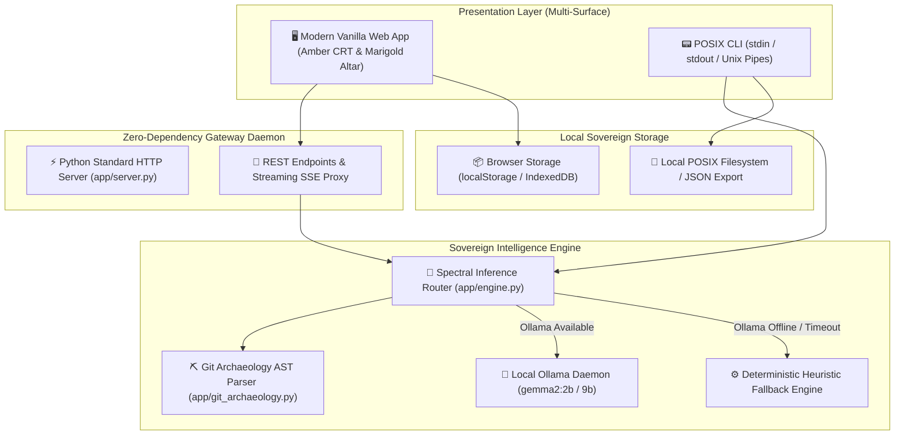
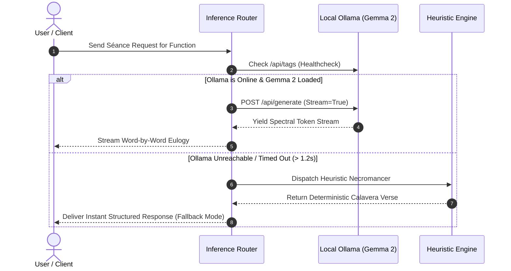
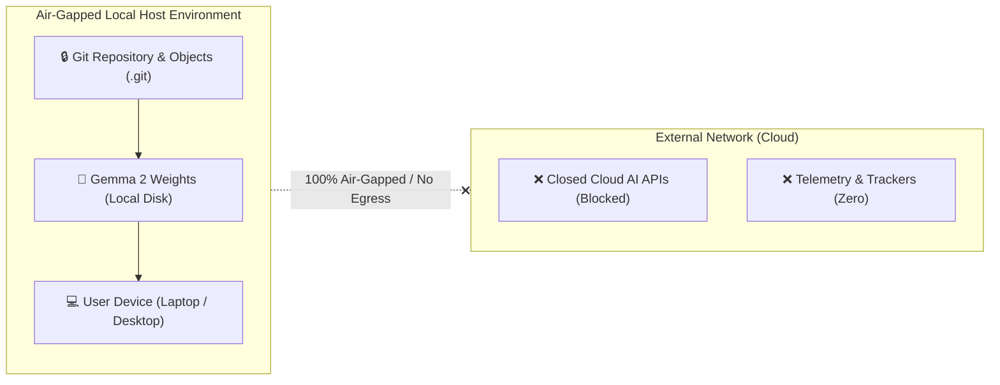

# 🏛️ NecroGit: System Architecture & Technical Design (ARCHITECTURE.md)

**Project:** NecroGit (The Air-Gapped Code Séance & Digital Ofrenda)  
**Author:** Arnav Patel ([@XiaoArnav](https://github.com/XiaoArnav))  
**Repository:** [https://github.com/XiaoArnav/necrogit](https://github.com/XiaoArnav/necrogit)  
**Status:** In Active Architecture / Implementation  
**License:** MIT  

---

## 1. High-Level Architectural Philosophy

NecroGit adheres to three core tenets established throughout our Hacktoberfest series:

1. **Zero External Runtime Dependencies:** The backend relies strictly on the Python 3.9+ Standard Library (`http.server`, `urllib.request`, `json`, `dataclasses`). No heavy virtual environments, no `pip install` friction, and zero supply-chain attack surface.
2. **Local-First & Air-Gapped Resilience:** AI inference runs entirely on the host machine via **Google Gemma 2** (`gemma2:2b` / `gemma2:9b`) through Ollama. When network connectivity is zero or Ollama is unconfigured, the system cascades gracefully into deterministic local heuristics.
3. **Multi-Surface Accessibility:** The core engine is decoupled from presentation layers, serving both an interactive browser ofrenda and a composable POSIX-compliant CLI stream.

---

## 2. Component Topology

### 2.1 The Web Presentation Layer
* **Vanilla Architecture:** Built without bundlers (Webpack/Vite/Rollup) or heavy frontend frameworks (React/Vue). Direct ES modules load instantly via native HTTP imports.
* **Amber Phosphorus CRT & Marigold Altar:** Canvas-rendered floating cempasúchil petals, glowing terminal amber phosphors, and Web Audio procedural synthesizer.
* **Visual Storytelling:** Integrated with **Ian Xiaohei** minimalist hand-drawn vector art and responsive status telemetry.

### 2.2 The Zero-Dependency Gateway (`app/server.py`)
* Implements `http.server.ThreadingHTTPServer` to handle concurrent local requests.
* Handles static asset serving, MIME resolution (`text/html`, `application/javascript`, `image/svg+xml`, `image/jpeg`), and CORS headers for local development.
* Acts as a non-blocking proxy forwarder to Ollama's local port (`11434`), streaming raw chunked tokens back to the web UI.

### 2.3 The Git Archaeology Engine (`app/git_archaeology.py`)
* Extracts deleted whole files (`git log -p --diff-filter=D -M`).
* Parses diff hunks to identify deleted function and class signatures in surviving files (`-def `, `-class `, `-function `).
* Resolves author attribution, commit date, and deletion commit messages.

### 2.4 The Inference Router & Local Gemma Engine (`app/engine.py`)

---

## 3. Data Flow & Security Boundary

* **No Egress Policy:** Absolutely no user telemetry, prompts, or output tokens are transmitted outside `localhost`.
* **Audit Defense:** Every generated report, token stream, or transaction can be verified against local source logs.
