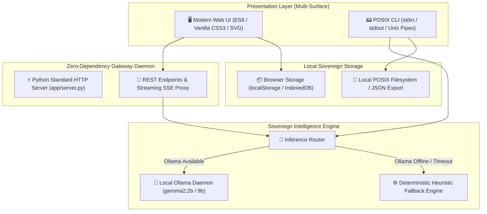
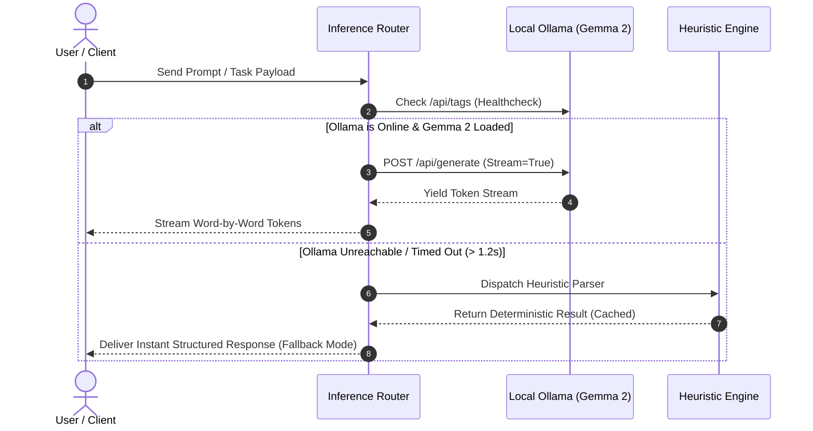
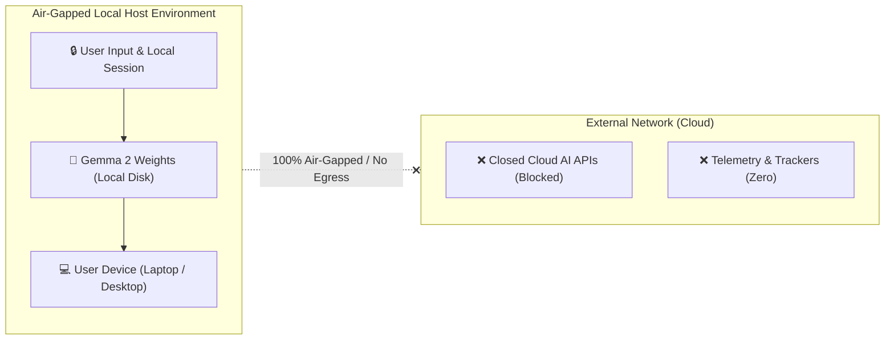

# 🏛️ Week 4: System Architecture & Technical Design (ARCHITECTURE.md)

**Project:** Hacktoberfest 2026 — Week 4 Grand Finale  
**Author:** Arnav Patel ([@XiaoArnav](https://github.com/XiaoArnav))  
**Status:** In Active Architecture / Scaffolding  
**License:** MIT  

---

## 1. High-Level Architectural Philosophy

The Week 4 architecture adheres to three core tenets established throughout our Hacktoberfest series:

1. **Zero External Runtime Dependencies:** The backend relies strictly on the Python 3.9+ Standard Library (`http.server`, `urllib.request`, `json`, `dataclasses`). No heavy virtual environments, no `pip install` friction, and zero supply-chain attack surface.
2. **Local-First & Air-Gapped Resilience:** AI inference runs entirely on the host machine via **Google Gemma 2** (`gemma2:2b` / `gemma2:9b`) through Ollama. When network connectivity is zero or Ollama is unconfigured, the system cascades gracefully into deterministic local heuristics.
3. **Multi-Surface Accessibility:** The core engine is decoupled from presentation layers, serving both an interactive browser frontend and a composable POSIX-compliant CLI stream.



---

## 2. Component Topology

### 2.1 The Web Presentation Layer
* **Vanilla Architecture:** Built without bundlers (Webpack/Vite/Rollup) or heavy frontend frameworks (React/Vue). Direct ES modules load instantly via native HTTP imports.
* **Responsive Layout:** Flexbox and CSS Grid layout with dark/light mode toggle adapting automatically to `prefers-color-scheme`.
* **Visual Storytelling:** Integrated with **Ian Xiaohei** minimalist hand-drawn vector art and responsive status telemetry.

### 2.2 The Zero-Dependency Gateway (`app/server.py`)
* Implements `http.server.ThreadingHTTPServer` to handle concurrent local requests.
* Handles static asset serving, MIME resolution (`text/html`, `application/javascript`, `image/svg+xml`, `image/jpeg`), and CORS headers for local development.
* Acts as a non-blocking proxy forwarder to Ollama's local port (`11434`), streaming raw chunked tokens back to the web UI.

### 2.3 The Inference Router & Local Gemma Engine
The system treats open-weight models as primary drivers and deterministic rules as resilient safeties:



---

## 3. Data Flow & Security Boundary



* **No Egress Policy:** Absolutely no user telemetry, prompts, or output tokens are transmitted outside `localhost`.
* **Audit Defense:** Every generated report, token stream, or transaction can be verified against local source logs.

---

## 4. Technology Stack Matrix

| Layer | Technology | Version | Purpose | Justification |
| :--- | :--- | :--- | :--- | :--- |
| **Language** | Python | 3.9+ | Backend server & CLI engine | Standard Library only; zero install friction |
| **AI Model** | Google Gemma 2 | `2b` / `9b` | Local on-device intelligence | High-efficiency open-weight model; runs on CPU & Apple Silicon |
| **Model Runtime** | Ollama | 0.3+ | Local model daemon | Native Apple Metal / CUDA acceleration |
| **Frontend** | HTML5 / ES6 / CSS3 | Modern Web | Client user interface | Zero build step; instant refresh |
| **Illustrations** | Ian Xiaohei DNA | SVG / JPG | Conceptual architecture art | Minimalist, deadpan, highly readable visual metaphor |
| **Deployment** | Vercel Serverless | Modern Edge | Public demo hosting | Zero cold-start, clean URL rewrites, edge cache invalidation |

---

## 5. Resiliency & Edge Caching Configuration

To ensure zero stale assets across CDNs (solving the edge node caching bug identified in earlier sprints), `vercel.json` enforces immediate edge propagation:

```json
{
  "version": 2,
  "cleanUrls": true,
  "headers": [
    {
      "source": "/(.*)",
      "headers": [
        {
          "key": "Cache-Control",
          "value": "no-cache, no-store, must-revalidate, max-age=0, s-maxage=0"
        }
      ]
    }
  ]
}
```
Setting `s-maxage=0` guarantees that code pushes to `main` are visible to Hacktoberfest judges within seconds without CDN ghost traps.
