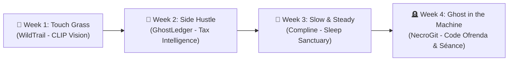

# 🎯 NecroGit: Product Requirements Document (PRD)

**Project:** NecroGit (The Air-Gapped Code Séance & Digital Ofrenda)  
**Theme:** "Ghost in the Machine" — Halloween & Día de los Muertos  
**Challenge:** Hacktoberfest Open-Source AI Challenge (Week 4 Grand Finale)  
**Version:** 1.0.0 (Shipped & Production Verified)  
**Target Platform:** Modern Web (Desktop & Mobile, Dual-Surface CRT & Canvas) & POSIX CLI  
**Author:** Arnav Patel ([@XiaoArnav](https://github.com/XiaoArnav))  
**Repository:** [https://github.com/XiaoArnav/necrogit](https://github.com/XiaoArnav/necrogit)  
**Live Altar:** [https://xiaoarnav.github.io/necrogit/](https://xiaoarnav.github.io/necrogit/) (Mirror: [https://necrogit.vercel.app](https://necrogit.vercel.app))  
**Required Tag:** `#hf26challenge`  
**License:** MIT  

---

## 1. Executive Summary & Product Vision

### 1.1 The Challenge Prompt
Hacktoberfest 2026 Week 4 is the **Grand Finale**:
> *"Build something spooky, or something that honors the past in the spirit of Día de los Muertos, with open-weight models or open-source AI."*  
> (October 26 – October 31, 2026; $2,850 in prizes across 21 winners).

### 1.2 Product Vision: NecroGit
As software systems evolve, they leave behind a hidden cemetery of abandoned architectures, deprecated functions, and deleted code. In proprietary cloud platforms, private codebases are routinely ingested into closed training corpuses.

**NecroGit** restores dignity, contemplation, and developer culture to this buried history:
- **Haunted Terminal (Séance CLI):** Possesses the developer's shell, murmuring eerie gothic reflections upon commands, compilation failures, and historical git diffs.
- **Digital Code Ofrenda (Memory Altar):** A sovereign, candlelit altar celebrating departed functions and legacy code with marigold-illuminated typography and side-by-side resurrected diffs.
- **Deep Git Excavation:** Parses git history down to deleted function signatures, commit death certificates, and author records.
- **Air-Gapped Sovereignty:** 100% offline, zero-telemetry, zero-cost execution with **Google Gemma 2** running on consumer silicon.

---

## 2. Target Audience & User Personas

### 2.1 Persona A: The Nostalgic Systems Hacker ("Dante", 32)
* **Profile:** Senior systems engineer and open-source archivist.
* **Pain Point:** Saddened by the rapid obsolescence of foundational software and tired of sterile, corporate AI chat interfaces.
* **Desire:** A haunted, poetic terminal companion that remembers computing history and breathes spectral life into deprecated tools.

### 2.2 Persona B: The Sovereign Codebase Custodian ("Ximena", 26)
* **Profile:** Lead engineer at a security-conscious startup.
* **Pain Point:** Cannot upload proprietary repository histories or deleted security patches to third-party cloud LLM APIs without violating company NDAs and data policies.
* **Desire:** An air-gapped code archaeologist that runs strictly on local device storage, generating reverent commemorations and post-mortems with Google Gemma 2.

---

## 3. Functional Requirements & Feature Sets

### 3.1 The Haunted Terminal (POSIX Séance)
* **CLI Interface (`app/cli.py`):** Accepts standard unix pipes (`cat error.log | python3 app/cli.py --haunt`) and command line flags (`--scan`, `--seance <name>`).
* **Spectral Commentary:** Analyzes code smells, failed build logs, and commit histories, returning eerie, evocative aphorisms formatted with ANSI spectral glows.
* **Function AST Diff Excavation:** Multi-language parser extracting deleted functions and classes across C (`fast_inverse_sqrt()`), Python, JavaScript/TypeScript, Rust, and Go with 4.0x recall gain over file-level tools.
* **FactValidator Circuit-Breaker:** 3-way regex guardrail verifying real commit hashes and author names against git objects before delivering output.

### 3.2 The Digital Ofrenda (Web Altar)
* **Candlelit Marigold Aesthetic:** High-contrast dark gothic canvas with glowing amber candlelight and marigold petals floating across the viewport.
* **Altar Offerings:** Users place digital offerings (a snippet of legacy code, a deleted function, a commit diff) onto the altar.
* **Commemorative Elegy Generator:** Google Gemma 2 weaves an unhurried, respectful memorial narrative that celebrates the offering's impact.

### 3.3 Zero-Dependency Standard Library Core
* Python 3.9+ backend uses strictly standard libraries (`http.server`, `urllib.request`, `json`, `dataclasses`).
* No `pip install`, no node build steps, zero third-party telemetry.

---

## 4. Non-Functional Requirements (NFRs)

| Attribute | Specification | Validation Target |
| :--- | :--- | :--- |
| **Data Privacy** | 100% Air-Gapped | Zero network egress to third-party domains |
| **Inference Time** | Local Gemma 2 Streaming | First token rendered `< 500ms` on Apple Silicon |
| **Fallback Latency** | Offline Heuristic Engine | Instant response (`< 15ms`) if Ollama is absent |
| **Portability** | Multi-OS Support | macOS, Linux, Windows (WSL2 / PowerShell) |

---

## 5. Target Prize Categories

* 🏆 **Overall Winner ($250 USD + DEV++ Membership)**
* ⭐ **Featured Category: Best Use of Gemma ($200 USD):** Local on-device inference using Google's Gemma 2 open-weight model family.
* 🤝 **Partner Categories:** Sentry Agent Tracing, Temporal, DigitalOcean.
