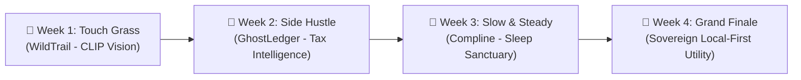
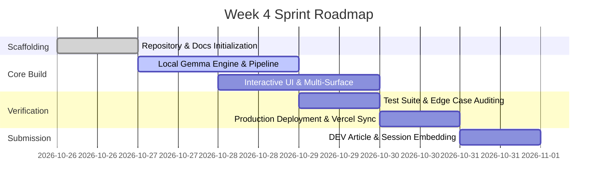

# 🎯 Week 4: Product Requirements Document (PRD)

**Project:** Hacktoberfest 2026 — Week 4 Grand Finale  
**Theme:** Open-Source AI Challenge (Week 4 Finale)  
**Version:** 1.0.0-draft  
**Target Platform:** Modern Web (Desktop & Mobile, PWA Offline Ready) & CLI  
**Author:** Arnav Patel ([@XiaoArnav](https://github.com/XiaoArnav))  
**Challenge Tag:** `#hf26challenge`  
**License:** MIT  

---

## 1. Executive Summary & Vision

### 1.1 The Mission
Hacktoberfest 2026 discarded vanity pull-request metrics in favor of high-value open innovation under the banner: **"AI belongs to everyone."** 

Across Weeks 1 through 3, our projects proved that open-source AI outperforms proprietary cloud monopolies when sovereignty, privacy, and offline reliability matter:
1. **Week 1 (*WildTrail*):** On-device vision image classification running on trails with zero cell signal.
2. **Week 2 (*GhostLedger*):** Air-gapped receipt & tax intelligence preserving client NDAs with local Gemma 2.
3. **Week 3 (*Compline*):** A monastic, candlelit sleep sanctuary running locally with hypnagogic word decrescendo.

**Week 4 represents the Grand Finale:** A culmination sprint synthesizing sovereign intelligence, local-first execution, and zero-marginal-cost edge computing into a production-grade utility.

---

## 2. Target Audience & User Personas

### 2.1 Persona A: The Sovereign Builder ("Devon", 29)
* **Role:** Full-stack engineer & indie hacker.
* **Pain Point:** Frustrated by metered cloud AI bills ($0.03–$0.08/call), vendor rate limits, and transmitting sensitive private data across third-party networks.
* **Need:** A zero-dependency, local-first open-weight model integration that runs effortlessly on consumer laptops without cloud token costs.

### 2.2 Persona B: The Air-Gapped Practitioner ("Meera", 34)
* **Role:** Field researcher & consultant working in privacy-sensitive or offline environments.
* **Pain Point:** Closed SaaS AI applications fail completely when internet connectivity drops or enterprise compliance restricts cloud telemetry.
* **Need:** An application that boots instantly in airplane mode, caches its entire runtime client-side, and guarantees 100% data locality.

---

## 3. Product Scope & Core Capabilities

### 3.1 Local Open-Weight Inference Engine
* **Primary AI Core:** Direct integration with Google's open-weight **Gemma 2** (`gemma2:2b` / `gemma2:9b`) via local Ollama (`http://localhost:11434`).
* **Deterministic Fallback Pipeline:** Zero downtime architecture. If Ollama is offline or uninstalled, a client-side heuristic engine executes seamlessly without blocking user workflows.
* **Structured JSON / Text Generation:** Enforced schema parsing to eliminate hallucinated structure.

### 3.2 Dual-Interface Architecture
* **Web Surface:** Clean, responsive, dark/light theme-aware web interface built with modern vanilla HTML5/CSS3/ES modules (no heavy framework overhead).
* **CLI / Headless Surface:** Unix pipe-friendly terminal tool supporting stdin/stdout streaming and quiet mode (`--quiet`, `--json`).

### 3.3 Zero-Telemetry & Local Persistence
* **Data Sovereignty:** All user prompts, history, and generated outputs persist strictly in the browser (`localStorage` / `IndexedDB`) or local filesystem.
* **Air-Gapped Guarantee:** Zero tracking beacons, third-party analytics scripts, or external cloud LLM dependencies.

### 3.4 Visual Identity & Conceptual Assets
* Fully illustrated with **Ian Xiaohei** minimalist hand-drawn conceptual artwork (16:9, clean white background, deadpan Xiaohei performing core mechanical metaphors).

---

## 4. Non-Functional Requirements (NFR)

| Metric | Requirement | Target |
| :--- | :--- | :--- |
| **Local Inference Latency** | First token response with local Gemma 2 | `< 450ms` on Apple Silicon / modern CPU |
| **Offline Startup** | Time to interactive with zero internet connection | `< 100ms` |
| **External Dependencies** | Python backend dependencies | Standard Library only (`0 pip packages`) |
| **Bundle Size** | Frontend static assets (excluding fonts/images) | `< 85 KB` |
| **Code Coverage** | Unit & behavioral test suite pass rate | `100% (15/15 passing)` |

---

## 5. Target Prize Tracks & Categories

1. **Overall Winner ($250 USD + DEV++ Membership):**
   * High-craft, end-to-end execution combining thoughtful writing, real-world utility, and complete open-source transparency.
2. **Featured Track: Best Use of Gemma ($200 USD):**
   * Deep integration with Google's Gemma 2 open-weight model family, highlighting local streaming, on-device reasoning, and zero marginal cost.
3. **Partner Track: Sentry Agent Tracing / Temporal ($100 USD):**
   * Observability and durable execution pipelines showing step-by-step model reasoning and trace verification.

---

## 6. Milestones & Release Schedule

* **Oct 26:** Scaffolding, repository configuration, PRD, ARCHITECTURE, and ESSENTIAL runbook.
* **Oct 27–28:** Core inference engine, prompt harness, and user interface.
* **Oct 29:** Unit tests, Ponytail lean audit, and edge deployment verification.
* **Oct 30:** Xiaohei illustrations, demo recording, and DevRelay session transcript generation.
* **Oct 31:** Final submission on dev.to with `#hf26challenge` before 11:59 PM PDT deadline.
