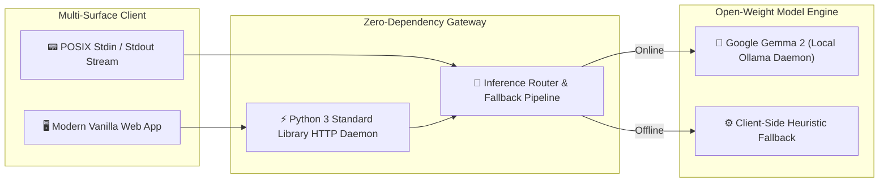

# 👑 Week 4: The Grand Finale — Hacktoberfest 2026

[](LICENSE)
[](https://hacktoberfest.com)
[](https://dev.to/challenges/hacktoberfest-week4-2026-10-26)
[](https://ai.google.dev/gemma)
[-brightgreen.svg)](#)

> **"AI belongs to everyone."**  
> The final sprint of Hacktoberfest 2026: building with open-weight models, sovereign local execution, zero marginal token cost, and complete air-gapped privacy.

---

## 🎨 The Grand Finale Roadmap (Xiaohei Edition)


*Xiaohei hauling the red countdown clock toward the October 31 finish line, fed by the shipped progression of Week 1 ([WildTrail](https://github.com/XiaoArnav/wildtrail)), Week 2 ([GhostLedger](https://github.com/XiaoArnav/ghostledger)), and Week 3 ([Compline](https://github.com/XiaoArnav/complineapp)) directly into Completionist status.*

---

## 🏛️ System Architecture at a Glance



---

## 🚀 Quickstart

Run with pure Python 3.9+ with **zero external pip dependencies**:

```bash
# 1. Clone the repository
git clone https://github.com/XiaoArnav/week-4.git
cd week-4

# 2. Run the local server daemon
python3 app/server.py
```

Then navigate to [`http://localhost:7777`](http://localhost:7777) in your browser.

### Connect Local Gemma 2 (Optional but Recommended)
For fully private, on-device AI inference with Google's open-weight model:
```bash
ollama run gemma2:2b
```

---

## 📚 Technical Documentation Index

| Document | Purpose & Description |
| :--- | :--- |
| **[`PRD.md`](PRD.md)** | Product Requirements Document: user personas, problem space, NFRs, and prize targets |
| **[`ARCHITECTURE.md`](ARCHITECTURE.md)** | System topology, inference routing, sequence diagrams, and cache engineering |
| **[`ESSENTIAL.md`](ESSENTIAL.md)** | Quickstart runbook, port assignments, environment variables, and troubleshooting |
| **[`hacktoberfest-week4-schedule.ics`](hacktoberfest-week4-schedule.ics)** | Direct Notion Calendar / Google Calendar sync for Week 4 milestones |

---

## 🏆 Target Prize Tracks

* 🥇 **Overall Winner:** Open-source AI project with comprehensive technical execution and writeup.
* ⭐ **Featured Category: Best Use of Gemma ($200):** Air-gapped on-device inference using Google's Gemma 2 open-weight models.
* 🤝 **Partner Categories:** Sentry Agent Tracing, Temporal durable workflows, DigitalOcean.

---

## 📄 License

This project is licensed under the [MIT License](LICENSE) — see the LICENSE file for details. Built with 💚 for Hacktoberfest 2026.
