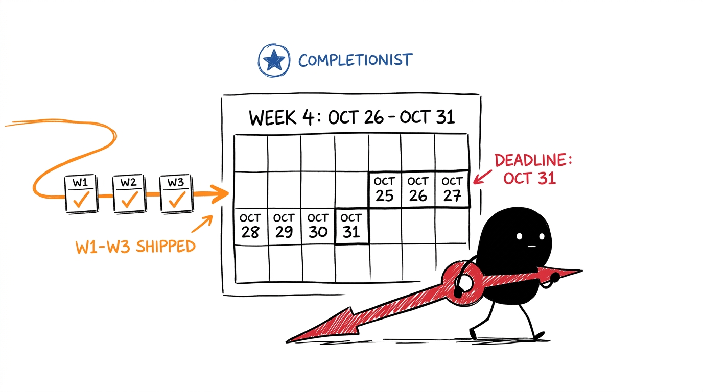
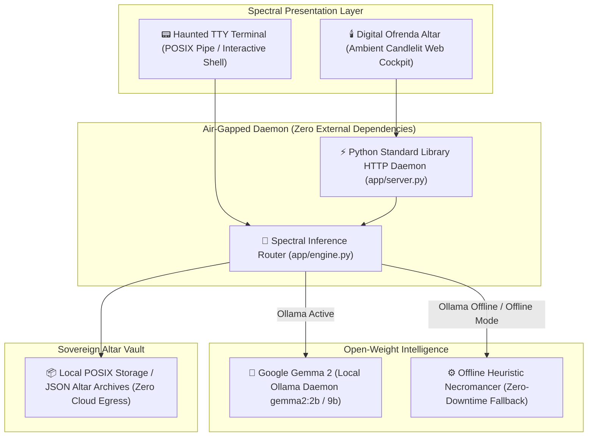

# 👻 Ghost in the Machine — Hacktoberfest 2026 (Week 4 Grand Finale)

[](LICENSE)
[](https://hacktoberfest.com)
[](https://dev.to/challenges/hacktoberfest-week4-2026-10-26)
[](https://dev.to/t/hf26challenge)
[](https://ai.google.dev/gemma)
[](#)

> **"Between the past and the present, the line grows thinner."**  
> Built for the **Hacktoberfest Open-Source AI Challenge: Week 4 ("Ghost in the Machine")** celebrating Halloween and Día de los Muertos (October 26 – October 31, 2026).  
> A sovereign, air-gapped terminal séance and digital remembrance vault powered entirely by **Google Gemma 2** running on local silicon.

---

## 🎨 The Grand Finale Roadmap (Xiaohei Edition)



*Xiaohei hauling the red countdown clock toward the October 31 midnight deadline, fed by the stamped progression of Week 1 ([WildTrail](https://github.com/XiaoArnav/wildtrail)), Week 2 ([GhostLedger](https://github.com/XiaoArnav/ghostledger)), and Week 3 ([Compline](https://github.com/XiaoArnav/complineapp)) directly into Completionist status.*

---

## 🕯️ The Concept: What is "Ghost in the Machine"?

When Halloween arrives on October 31 and Día de los Muertos follows on November 1–2, the barrier separating digital memory from the living machine dissolves. 

Most modern AI systems are corporate specters: closed cloud APIs that hoard your memories, telemetry, and terminal histories on external server farms to train proprietary models. 

**Ghost in the Machine (Phantasm)** turns that model on its head:
1. **The Haunted Terminal (POSIX Séance):** Channels the departed spirits of deprecated programming languages, deceased hardware architectures, and abandoned open-source tools directly into your CLI with eerie, poetic machine commentary.
2. **The Digital Ofrenda:** An intimate, sovereign altar for memories, lost software codebases, and digital artifacts. You can write remembrances, preserve oral histories, and weave commemorative folklore.
3. **100% Air-Gapped & Offline:** Operates entirely with the lights and the internet turned off. All model weights and memory tokens remain strictly on your local disk.

---

## 🧠 Why Open Innovation Matters Here

The challenge explicitly asks: *Why does open innovation matter for what you built?*

| Closed Cloud LLM Monopolies | Phantasm (Open-Weight Google Gemma 2) |
| :--- | :--- |
| ❌ Intimate memories and family histories uploaded to cloud servers | ✅ **100% Data Sovereignty:** Memories never leave local disk |
| ❌ Fails completely when internet connectivity drops | ✅ **True Offline Séance:** Runs in pitch darkness or airplane mode |
| ❌ Metered token taxes ($0.03–$0.08/call) bleed users | ✅ **Zero Marginal Cost:** 100% free to run on CPU or Apple Silicon |
| ❌ Closed training sets determine censorship and style | ✅ **Sovereign Personality:** Local system prompt tuning and model control |

---

## 🏛️ System Architecture



---

## 🚀 Quickstart

Run with pure Python 3.9+ with **zero external pip dependencies**:

```bash
# 1. Clone the repository
git clone https://github.com/XiaoArnav/week-4.git
cd week-4

# 2. Launch the local daemon
python3 app/server.py
```

Then navigate to [`http://localhost:7777`](http://localhost:7777) in your browser.

### Connect Local Google Gemma 2 (Offline & Air-Gapped)
In a separate terminal window, warm up Google's open-weight model:
```bash
ollama run gemma2:2b
```

### Haunted Terminal CLI Mode
```bash
# Direct CLI terminal invocation
python3 app/cli.py --seance "Resurrect the spirit of Turbo Pascal"

# Pipe shell logs or historical diffs directly into the machine
git log -n 5 | python3 app/cli.py --haunt
```

---

## 📚 Technical Documentation Index

| Document | Purpose & Description |
| :--- | :--- |
| **[`PRD.md`](PRD.md)** | Product Requirements Document: problem space, personas, and Día de los Muertos specs |
| **[`ARCHITECTURE.md`](ARCHITECTURE.md)** | Technical design, inference router, sequence diagrams, and air-gapped security boundary |
| **[`ESSENTIAL.md`](ESSENTIAL.md)** | Operational runbook, port assignments, Ollama setup, and troubleshooting cheatsheet |
| **[`hacktoberfest-week4-schedule.ics`](hacktoberfest-week4-schedule.ics)** | Direct Notion Calendar / Google Calendar sync for Week 4 milestones |

---

## 🏆 Target Prize Tracks

* 🥇 **Overall Winner ($250 USD):** High-craft open-source AI project with comprehensive technical execution and writeup.
* ⭐ **Featured Category: Best Use of Gemma ($200 USD):** Air-gapped on-device inference using Google's Gemma 2 open-weight models.
* 🤝 **Partner Categories:** Sentry Agent Tracing, Temporal durable workflows, DigitalOcean.

---

## 📄 License

This project is licensed under the [MIT License](LICENSE) — see the LICENSE file for details. Built with 💚 for Hacktoberfest 2026.
